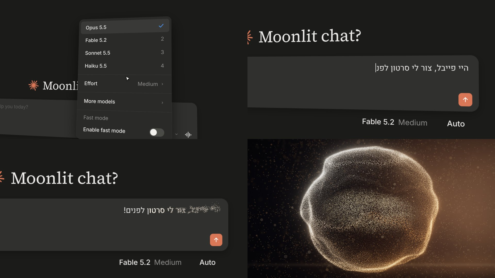
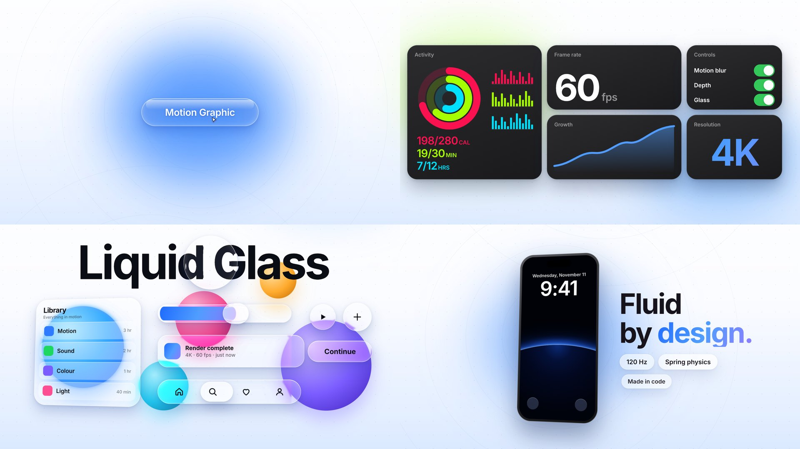
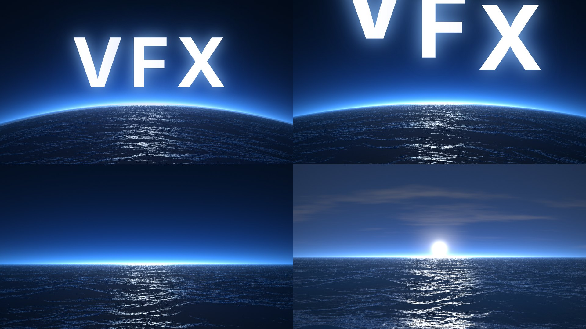
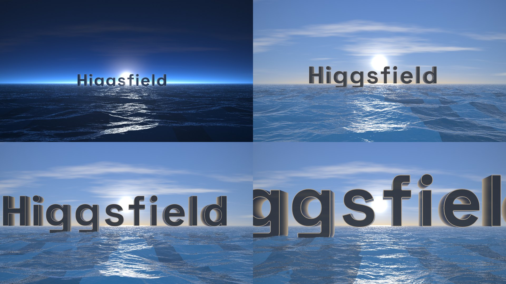
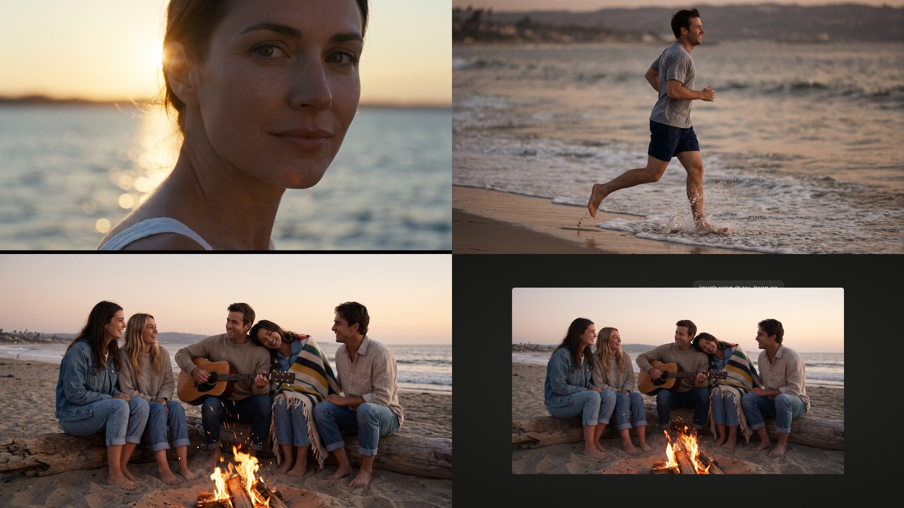
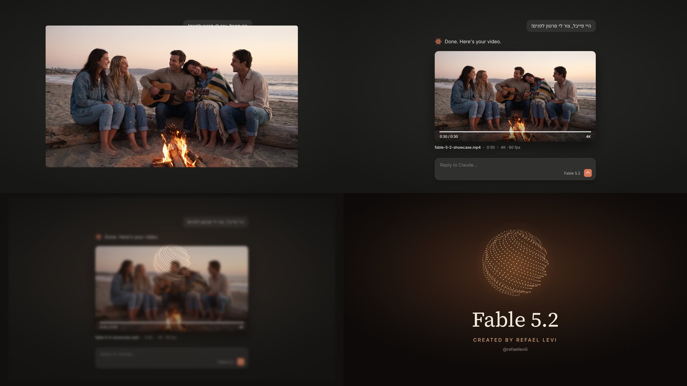

# איך יצרנו סרטון של 30 שניות עם Fable 5.2: מושן גרפיקס, VFX ווידאו מצולם ב-AI

**מאת רפאל לוי · @refaelleviii**

הסרטון הזה נבנה כולו בשיחה אחת עם Claude Code (מודל Fable 5.2). לא נפתחה תוכנת עריכה אחת. כתבתי מה אני רוצה לראות, קיבלתי פריימים לאישור, תיקנתי, והמשכנו לסצנה הבאה. המדריך מסביר מה עשינו בכל שלב, באילו כלים, ומה למדנו בדרך.

> **הערה למנהל האתר:** התמונות נמצאות בתיקייה `img/` לצד הקובץ הזה, וממוספרות לפי סדר הופעתן. את הסרטון עצמו (`fable_full_v2.mp4`) רפאל ישלח בנפרד, ומומלץ לשים אותו בראש העמוד. הפרומפטים באנגלית מיועדים להעתקה, אז כדאי להציג אותם בתיבת קוד עם כפתור העתקה.

---

## הסרטון בקצרה

| | |
|---|---|
| אורך | 30.2 שניות |
| פורמט | 16:9, ‏4K, ‏60 פריימים לשנייה |
| מבנה | חלון פרומפט ← מושן גרפיקס ← VFX ← וידאו מצולם ב-AI ← סיום |
| שפה על המסך | אנגלית בלבד, חוץ מהפרומפט שמוקלד בעברית |

## הכלים

| כלי | מה הוא עשה |
|---|---|
| **Claude Code** עם **Fable 5.2** | כתב את כל הקוד, ניהל את התהליך, יצר את התמונות, הווידאו והסאונד דרך הכלים האחרים |
| **HyperFrames** | הופך דף HTML עם אנימציה לקובץ וידאו, פריים אחרי פריים |
| **GSAP** | תזמון האנימציות |
| **Three.js ו-WebGL** | כדור הנקודות התלת־ממדי והים |
| **Higgsfield** | תמונות רפרנס (Cinema Studio 2.5) והפיכתן לווידאו (Seedance 2.5) |
| **ElevenLabs** | הקול, המוזיקה וחלק מאפקטי הסאונד |
| **ffmpeg** | מיקס הסאונד |
| **מק עם שבב M1** | הרינדור הסופי ב-4K |

## שיטת העבודה

העיקרון שחזר בכל שלב: **לא ממשיכים לפני שמאשרים**.

1. מתארים סצנה אחת במילים.
2. Claude בונה אותה ושולח פריימים בודדים.
3. מתקנים עד שזה נראה נכון.
4. מרנדרים במק כדי לראות את התנועה, ורק אז עוברים לסצנה הבאה.

לכל סצנה שעולה כסף (תמונות, וידאו, מוזיקה) Claude הציג קודם את העלות וחיכה לאישור.

---

## סצנה 1: חלון הפרומפט (0–6.4 שניות)



**מה רואים:** חלון הכתיבה של Claude. המודל מוחלף מ-Opus 5.5 ל-Fable 5.2, מוקלד במהירות "היי פייבל, צור לי סרטון לפנים!", האותיות הופכות לנקודות, והנקודות מתאספות לכדור תלת־ממדי שאומר "עליי".

**איך זה נבנה:**
- חלון הכתיבה שוחזר מצילום מסך של החלון האמיתי, כדי שייראה זהה למקור.
- האותיות מצוירות על קנבס, כל פיקסל של אות הופך לנקודה, והנקודות עפות אל הכדור.
- הכדור הוא 130 אלף נקודות ב-Three.js, והוא מגיב לעוצמת הקול.
- הקול נוצר ב-ElevenLabs.

**מה למדנו:**
- רקע שחור "מת" נראה זול. הוספנו הילה, ערפל ונקודות אור רכות ברקע.
- המצלמה צריכה לזוז כל הזמן ולהיות חלק מהסיפור: להתקרב להקלדה, להתרחק כשהאותיות עפות.
- כדי לקבל חדות של 4K אמיתי, כל הקנבסים מצוירים ברזולוציה כפולה ולא נמתחים.

## סצנה 2: מושן גרפיקס (6.4–13.6 שניות)



**מה רואים:** הכדור מתכווץ ומתפוצץ, המסך מתלבן, ומופיע כפתור זכוכית "Motion Graphic". העכבר לוחץ, והמצלמה עוברת בין אזורים על לוח גדול פי שישה מהמסך: כרטיסיות בסגנון אפל, מסך "Liquid Glass", ואייפון שעל המסך שלו זריחה מהחלל. המצלמה נכנסת לתוך האייפון, והמילה VFX עולה מאחורי קו האופק.

**איך זה נבנה:**
- לוח אחד גדול ב-HTML, והמצלמה היא פשוט הזזה והגדלה של הלוח, עם טשטוש לפי מהירות התנועה.
- אפקט הזכוכית הנוזלית: שכבת טשטוש רקע יחד עם מפת עיוות שמכופפת את מה שמאחורי השוליים, כמו עדשה.
- הזריחה: עיגול ענק עם זוהר כחול בשוליים.

**מה למדנו:**
- **המעבר מהכדור צריך להיות בצבע של הכדור.** בגרסה הראשונה נפתח עיגול כחול על רקע חום, וזה נראה לא קשור. התיקון: העיגול נפתח בצבע הענבר של הנקודות, מתלבן ככל שהמצלמה נכנסת, ורק אז מופיע התכלת.
- **תקלה שעלתה לנו שעה:** האייפון הופיע בפריימים הבודדים ונעלם ברינדור המלא. חשדנו בכרטיס המסך, ברזולוציה ובהטיה התלת־ממדית. בסוף הסיבה הייתה פשוטה: לאייפון ולטקסט בחלון הפרומפט היה אותו שם פנימי בקוד, וכשהטקסט הוסתר, האייפון הוסתר איתו. הלקח: כשמשהו נעלם רק ברינדור, קודם משחזרים את הרינדור עצמו במקום לנחש.

## סצנה 3: ה-VFX, טיסה מהחלל אל הים (13.3–19.3 שניות)



**מה רואים:** ברגע שהאותיות VFX מתיישבות, המצלמה מתחילה לטוס קדימה כמו רחפן. האותיות עולות ויוצאות מהפריים, קו האופק המעוגל של כדור הארץ מתיישר, והחלל הופך לים לילי כחול. השמש מציצה, עולה, והים הופך לים של יום.

**איך זה נבנה:**
- כל הים והשמיים הם תוכנית גרפית אחת (shader) שמחשבת כל פיקסל: גובה הגלים, ההשתקפות של השמיים במים, והנצנוץ של השמש.
- שני רפרנסים הנחו את הצבעים: תמונה של "ים חללי" כהה ותמונה של ים ביום.

**מה למדנו:**
- **תחושת טיסה באה מהמשטח שזז מתחתיך.** בגרסה הראשונה המצלמה ירדה מלמעלה והמים "עמדו". התיקון: המים זורמים כבר מהרגע הראשון, והמצלמה טסה בגובה קבוע.
- **השמש לפני האור.** בגרסה הראשונה השמיים התבהרו לפני שהשמש עלתה. התיקון: קודם רואים את השמש מציצה, ורק כשהיא עולה המסך מתבהר.

## סצנה 4: האותיות Higgsfield (16–19.3 שניות)



**מה רואים:** המילה Higgsfield עולה מתוך הים מול השמש, משתקפת במים ומטילה צללים ארוכים. המצלמה טסה אל הרווח שבין האותיות, והמסך מתלבן אל תוך השמש.

**איך זה נבנה:**
- המילה מצוירת כתמונה, והתוכנית הגרפית מציבה אותה בעולם כ-28 שכבות צפופות, כך שלאותיות יש עובי.
- החומר: לכה שחורה מבריקה שמשקפת את השמיים, עם אור שמש חם שתופס את הקצוות ואת גב האותיות.

**מה למדנו:**
- **משתמשים בפונט האמיתי של המותג.** בגרסה הראשונה כתבנו HIGGSFIELD בפונט כללי. בדקנו באתר שלהם: הלוגו כתוב Higgsfield, בפונט Space Grotesk Bold.
- **חומר אמיתי במקום צבע שטוח.** חזית אפורה ופאות בז' נראו כמו קרטון. לכה שחורה עם השתקפויות נראית כמו אובייקט שעומד מול שמש.

## סצנה 5: וידאו מצולם ב-AI (19.3–25.5 שניות)



**מה רואים:** הלבן נפתח אל תקריב של אישה על חוף בשקיעה, אחריו גבר רץ על קו המים עם האטה ברגע שהרגל פוגעת במים, ולבסוף חבורה סביב מדורה. בפינה תווית "Seedance 2.5".

**התהליך, בסדר הזה:**
1. **קודם תמונת רפרנס לכל שוט, ורק אחרי אישור הופכים אותה לווידאו.** כך לא מבזבזים קרדיטים של וידאו על סגנון לא נכון.
2. התמונות נוצרו ב-Higgsfield במודל Cinema Studio 2.5.
3. כל תמונה מאושרת הפכה לשוט של 4 שניות ב-Seedance 2.5, כשהיא משמשת כפריים הפותח.
4. מכל שוט נלקחו כשתי שניות. ההאטה בריצה נעשתה בעריכה ולא במודל, כדי לשלוט בדיוק ברגע.

### הפרומפט הקבוע לסגנון

בכל תמונה משנים רק את החלק `SCENE`, ושאר הפרומפט נשאר קבוע. זה מה שנותן לכל השוטים מראה של סרט הוליוודי משנות ה-90:

```text
SCENE
[Describe the characters, their clothing, location, expressions, actions, camera angle and composition here.]

VISUAL STYLE
Authentic high-budget 1990s Hollywood romantic drama cinematography, captured on premium 35mm motion picture film, beautifully restored from pristine original camera negatives in a high-end 4K film scan. The image must look like a genuine frame from a professionally shot live-action feature film, not an AI-generated image.

LIGHTING AND EXPOSURE
Soft, luminous, realistic cinematic lighting. Beautifully exposed faces with clear, detailed eyes, rich natural midtones, gentle fill light, dimensional facial lighting, softly illuminated shadows and elegant highlight roll-off. Balanced exposure with preserved details in both highlights and shadows. No muddy blacks, crushed shadows or underexposure. Natural practical light sources consistent with the environment.

SKIN AND PHYSICAL REALISM
Extremely lifelike human anatomy, natural facial proportions, authentic skin microtexture, visible pores, subtle imperfections, realistic fine facial hair, individual hair strands, natural eye reflections, physically believable fabric textures, realistic material behavior and nuanced, spontaneous human expressions. Preserve authentic imperfections and avoid idealized or artificially polished faces.

CINEMATOGRAPHY
Professional Hollywood cinematography, natural 50mm cinema-lens perspective for portraits, subtle optical depth of field, realistic lens rendering, precise focus on the subject's eyes, organic background separation, natural framing, cinematic composition and believable perspective. Premium theatrical image quality without excessive digital sharpness.

FILM COLOR AND FINISH
Refined 1990s photochemical film color science, natural warm skin tones, subtle creamy highlights, sophisticated neutral shadows, nuanced color separation, delicate organic 35mm film grain, extremely fine film texture, high-quality restoration, natural contrast and beautiful tonal transitions. Crisp subject details with authentic film softness. Nostalgic film character with modern restoration quality, never a degraded VHS recording.

FINAL QUALITY
Photographically convincing, emotionally believable, beautifully lit, high-detail cinematic film still with professional production design and seamless realism.

AVOID
CGI appearance, illustration, plastic skin, waxy faces, excessive skin smoothing, beauty filters, artificial HDR, overprocessing, aggressive sharpening, heavy grain, VHS scanlines, excessive haze, low resolution, blur on the primary subject, dark or muddy exposure, unnatural lighting, synthetic-looking fabrics, oversaturated colors, exaggerated facial features, uncanny expressions and artificial bokeh.
```

### דוגמה לפרומפט וידאו (התקריב)

```text
Continue this exact 35mm film frame as a live-action shot. Very slow, steady push-in toward the woman's face, ending in a macro-close view of her cheek and eye. She turns her head slightly toward the camera and her faint smile deepens; she blinks once, naturally. A light sea breeze moves loose strands of hair at her temple and behind her ear; fine baby hairs and the soft peach-fuzz on her cheek and jawline catch the low sun and glow against the backlight. Skin stays completely real: visible pores, fine freckles and pigmentation, tiny lines by the eyes, subtle sheen, micro-movements of the skin as she smiles. The setting sun behind her ear flickers and flares softly as she moves, sun glitter drifts on the out-of-focus sea. Shallow depth of field, focus held on her near eye. 1990s Hollywood romantic drama, photochemical colour, fine organic film grain, gentle gate weave. No skin smoothing, no beauty filter, no morphing, no change of identity, no text.
```

**מה למדנו:**
- **אותו מקום ואותה שעה בכל השוטים.** בסיבוב הראשון כל תמונה יצאה בחוף אחר ובשעה אחרת. התיקון: בוחרים תמונה אחת כעוגן, ונותנים אותה למודל כתמונת ייחוס למקום ולאור בשאר התמונות.
- **טקסט לבדו לא תמיד מספיק.** התקריב יצא פעם במדבר ופעם ביום מעונן. רק עם תמונת הייחוס הוא יצא בשקיעה על אותו חוף.
- **מחליפים מודל כשמודל נתקע.** מודל התמונות הרגיל נכשל ארבע פעמים ברצף, אז עברנו למודל הקולנועי.
- **שוטים קצרים ואיטיים נראים הכי אמיתיים:** תקריב בלי ידיים ובלי דיבור.

## סצנה 6: הסיום (25.5–30.2 שניות)



**מה רואים:** שוט המדורה קופא, מתכווץ, ומתגלה שהוא מתנגן בתוך שיחה עם Claude, כתשובה לפרומפט מתחילת הסרטון. אחר כך השיחה מתרחקת, כדור הנקודות חוזר, ומופיעים "Fable 5.2" והקרדיט.

**למה זה עובד:** הסיום סוגר את המעגל. הסרטון נפתח בבקשה "צור לי סרטון", ונגמר בכך שרואים שהסרטון שצפינו בו הוא התשובה.

---

## הסאונד

הסאונד נוסף רק בסוף, אחרי שהתמונה ננעלה.

**מוזיקה:** ארבעה קטעים נפרדים מ-ElevenLabs, אחד לכל חלק:

| זמן | אופי |
|---|---|
| 0–5.9 | דרמטי, בסגנון טריילר |
| 6.4–11.9 | קצבי וויראלי, נכנס על הפיצוץ של הכדור |
| 11.9–19.3 | שקט, רק קול הים והגלים |
| 19.3–25.5 | קצבי עם גיטרה אקוסטית, לשוטים המצולמים |
| 28.2 | אקורד סיום נועז ופתוח, שנבנה בקוד |

**אפקטים:**
- נבנו בקוד: תקתוקי מקלדת, קליקים, וושים למעברי מצלמה, מכה בפיצוץ, נצנוצים, רוח וים.
- נוצרו ב-ElevenLabs: אווירת חוף עם מדורה, והתזת מים מואטת.

**מה למדנו:**
- **קטע מוזיקה אחד ארוך לא עוקב אחרי מבנה.** ביקשנו קטע של 30 שניות עם ארבעה חלקים, והוא יצא אחיד. קטע נפרד לכל חלק נתן שליטה מלאה.
- **שקט הוא חלק מהפסקול.** הרגע שבו המוזיקה נעלמת ונשאר רק הים הוא מה שנותן לזריחה משקל.
- קטע דרמטי שנבנה לאט צריך הגברה וכיווץ, אחרת לא שומעים אותו בשניות הראשונות.

## הרינדור

- הענן שבו Claude עובד אין בו כרטיס מסך, והכדור התלת־ממדי מתרנדר שם בערך בפריים לשנייה. לכן שם בודקים רק פריימים בודדים.
- הרינדור המלא נעשה במק עם פקודה אחת, ולוקח כ-6 עד 10 דקות ל-30 שניות ב-4K:

```bash
npx --yes hyperframes@0.8.150 render -o ~/Desktop/fable_full.mp4 --fps 60 --workers 1 --resolution 4k
```

## כמה זה עלה

| | |
|---|---|
| שלושה שוטים של Seedance 2.5 (4 שניות, 1080p) | 192 קרדיטים ב-Higgsfield |
| ארבעה קטעי מוזיקה | כ-3,600 קרדיטים ב-ElevenLabs |
| שלושה אפקטי סאונד | כ-50 קרדיטים ב-ElevenLabs |

עלות תמונות הרפרנס ב-Higgsfield והקול ב-ElevenLabs לא נמדדה. כל שאר הסרטון (מושן גרפיקס, VFX, סיום, רוב האפקטים) נבנה בקוד בלי עלות נוספת.

## שבעה כללים שיצאו מהפרויקט

1. **סצנה אחת בכל פעם, עם אישור לפני שממשיכים.**
2. **אין רקע בצבע אחד.** תמיד הילה, עומק או טקסטורה.
3. **המצלמה חיה ויש לה סיבה לזוז.**
4. **כל מעבר נולד ממה שהיה על המסך:** צבע הכדור, קו האופק, הסנוור של השמש.
5. **תמונת רפרנס לפני וידאו,** ותמונת עוגן אחת לכל הסדרה.
6. **הפונט והלוגו של המותג נלקחים מהמקור.**
7. **סאונד בסוף, קטע מוזיקה נפרד לכל חלק.**
